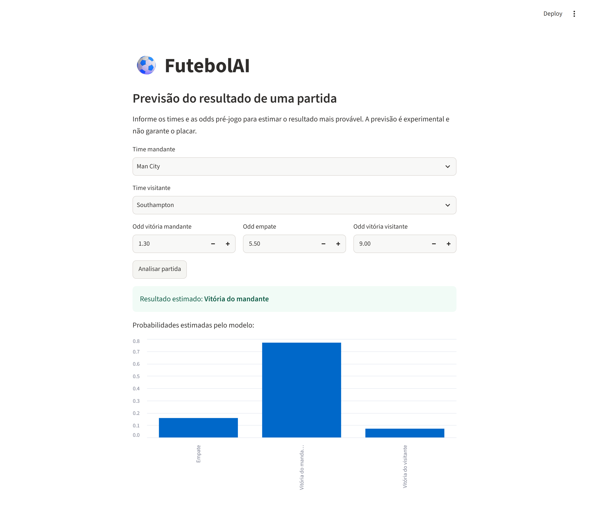

# ML Challenge — FutebolAI

## Problema
Estimar o resultado de uma partida da Premier League: vitória do time mandante (H), empate (D) ou vitória do visitante (A), utilizando nomes dos times e odds pré-jogo.

## Interface


## Dataset público
Dados históricos da Premier League disponibilizados por Football-Data.co.uk:
https://www.football-data.co.uk/englandm.php
O script baixa automaticamente as temporadas concluídas de 2020/21 a 2024/25 (5 temporadas, 1.900 partidas).

> Se a rede bloquear o site, baixe manualmente os arquivos para `data/` com os nomes
> `premier_league_2021.csv`, `premier_league_2122.csv`, `premier_league_2223.csv`,
> `premier_league_2324.csv` e `premier_league_2425.csv`. O script reaproveita arquivos existentes.

## Algoritmos
- Regressão Logística.
- Random Forest.

## Metodologia
Os dados são limpos, explorados e divididos em treino e teste (80/20), com estratificação e `random_state=42` (resultados reprodutíveis). Nomes dos times são codificados com OneHotEncoder e as odds são padronizadas. As métricas são calculadas apenas no conjunto de teste.

## Como executar no Windows
Requer Python 3.12 (testado com 3.12.10).

```powershell
py -m venv .venv
.\.venv\Scripts\pip install -r requirements.txt
.\.venv\Scripts\python train.py
.\.venv\Scripts\python -m streamlit run app.py
```

## Estrutura do projeto
```
.
├── app.py              # aplicação Streamlit
├── train.py            # download, análise, treino e avaliação
├── requirements.txt    # dependências com versões fixas
├── docs/               # screenshot usado neste README
├── data/               # CSVs baixados (gerados, não versionados)
├── models/             # modelo treinado (gerado, não versionado)
├── reports/            # métricas, log e gráficos (gerados, não versionados)
└── tests/              # teste de fumaça do app
```

## Resultados
Métricas reais no conjunto de teste (380 partidas), geradas por `train.py` e salvas em `reports/metricas.json`:

| Modelo | Acurácia | Precisão macro | Revocação macro | F1 macro |
|---|---|---|---|---|
| **Regressão Logística** (escolhido) | 56,05% | 48,60% | 48,96% | 46,13% |
| Random Forest | 49,47% | 44,96% | 45,36% | 45,04% |

- O melhor modelo é escolhido automaticamente pelo maior F1 macro.
- Baseline "sempre vitória do mandante": 43,2% de acurácia no teste — o modelo supera o baseline em cerca de 13 pontos percentuais.
- Empates são a classe mais difícil (F1 ≈ 0,13), comportamento esperado nesse tipo de problema.
- Duas execuções consecutivas geram exatamente o mesmo `metricas.json`.

## Métricas
Acurácia, precisão macro, revocação macro, F1 macro e matriz de confusão.

## Como testar
Com o modelo treinado:

```powershell
.\.venv\Scripts\python tests\smoke_test_app.py
```

O teste valida carga do app, opções de times, previsões, limites de odds, aviso de modelo ausente e probabilidades. Saída esperada: `16/16 passaram`.

## Limitações
O modelo utiliza odds pré-jogo, que representam estimativas de mercado e não informações completas sobre escalação, lesões, clima ou acontecimentos da partida. Não é garantia de resultado e não deve ser usado como recomendação de aposta.

## Uso de IA
Ferramentas de IA podem ter sido usadas como apoio à estruturação e explicação do código. O estudante deve executar, revisar e compreender os resultados antes da entrega.
